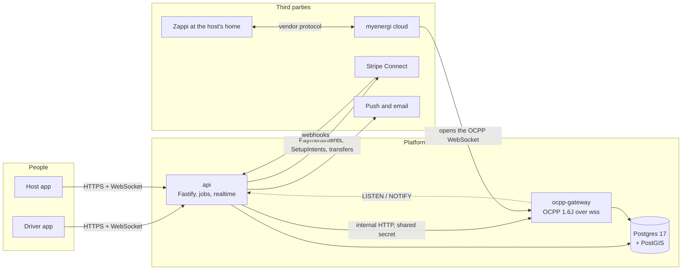
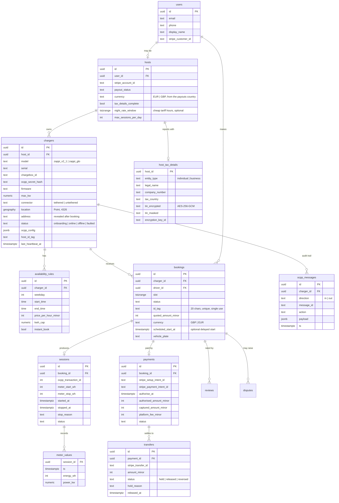
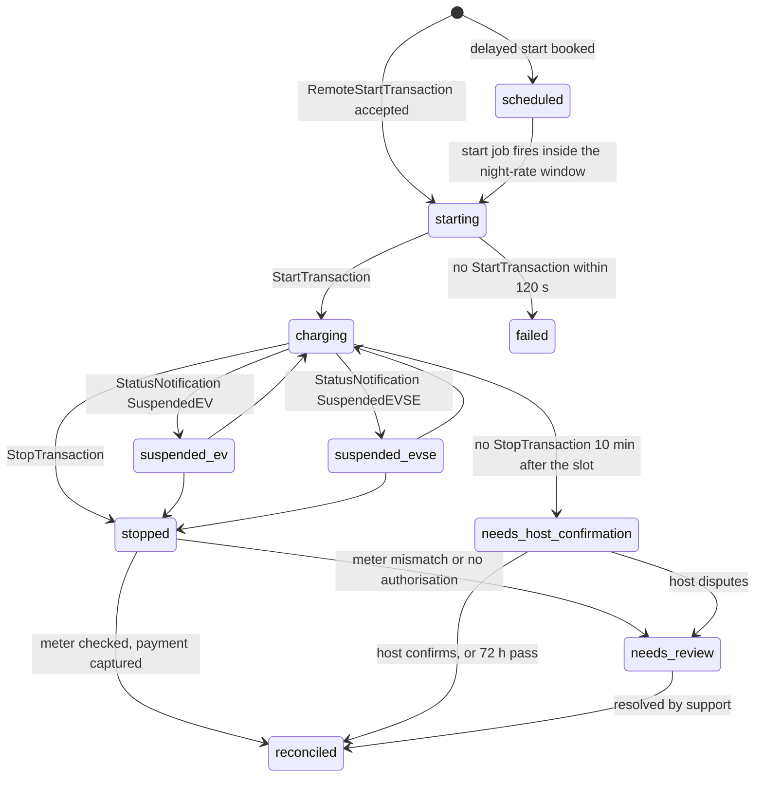
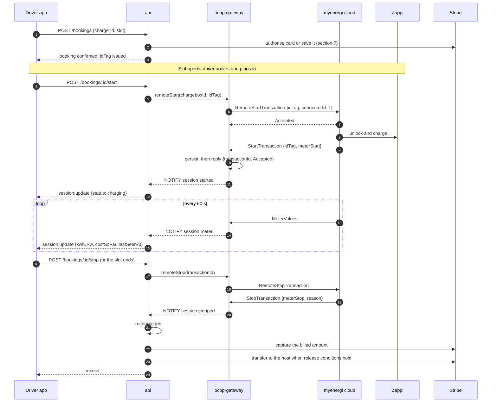

# Architecture

Peer-to-peer home EV charger sharing. A host lists a home charger, a driver books a slot (usually overnight), and the platform unlocks the charger over OCPP for that booking only, meters the session, charges the driver and pays the host.

This document describes the back end. The driver and host app is designed separately and will be added to the repository later. Key decisions are recorded in [docs/adr/](adr/).

## 1. Scope of the first version

| Area     | First version                                                                                                                                   | Later                                             |
| -------- | ----------------------------------------------------------------------------------------------------------------------------------------------- | ------------------------------------------------- |
| Chargers | myenergi Zappi v2.1 (serial starts with `2`) and Zappi GLO, firmware 5.794 or later, over OCPP 1.6J. Tethered and untethered. No 3-pin sockets. | Other brands, behind per-charger capability flags |
| Drivers  | Find a charger on a map, book a slot, start and stop from the app, live kWh, receipt, rating                                                    | Recurring bookings, favourites                    |
| Pricing  | Host sets a price per hour and a kWh cap. Billing is by time used; metered kWh is shown to both sides                                           | Per-kWh billing once metering accuracy is settled |
| Payments | Stripe Connect Express, separate charges and transfers (section 7)                                                                              | Promotions, fleet invoicing                       |
| Access   | Charger idles locked; each booking gets its own single-use OCPP idTag; the app starts the session remotely                                      | RFID cards                                        |
| Evidence | Every OCPP message and meter value stored per session                                                                                           | A second evidence source from the vendor's API    |
| Market   | UK and Ireland                                                                                                                                  |                                                   |

The platform charges no service fee in the first version. The fee is a configuration value (`PLATFORM_FEE_BPS`, default `0`), so it can be introduced without a schema change.

## 2. System context



**The charger never connects to us directly.** The host enters our OCPP URL and a ChargeboxID in their myenergi account, and myenergi's cloud opens the WebSocket to our public endpoint for them. As a result:

- The gateway must be reachable on a stable public hostname with a valid TLS certificate.
- A Zappi can be bound to only one OCPP backend at a time. Onboarding detects a charger that is already bound elsewhere and stops.
- Every link is cloud to cloud over the host's home internet. Session state in the app is always "last known at time T", never assumed live.
- OCPP has no way to fetch past usage. Anything the gateway did not record when it happened is gone, so the gateway writes every message to the database before it acknowledges it.

## 3. Deployables and repository layout

There are two deployable processes plus Postgres. There is no Redis and no separate worker ([ADR 0002](adr/0002-single-gateway-and-postgres-notify.md)).

| Deployable     | Responsibilities                                                                                                                                                                     |
| -------------- | ------------------------------------------------------------------------------------------------------------------------------------------------------------------------------------ |
| `api`          | REST API with Zod-validated bodies and generated OpenAPI; auth (Better Auth); realtime WebSocket for apps; Stripe calls and webhooks; background jobs (pg-boss on the same Postgres) |
| `ocpp-gateway` | OCPP 1.6J central system: WebSocket endpoint, Zappi profile, message persistence, `ChargerControl` commands. One instance holding the socket map in memory                           |
| Postgres       | Postgres 17 with PostGIS. System of record, job queue and event bus between the two processes                                                                                        |

```
apps/
  api/            Fastify 5 API, jobs, realtime, webhooks
  ocpp-gateway/   OCPP 1.6J central system
packages/
  config/         tsconfig, ESLint and Vitest presets; typed env parsing
  db/             Drizzle ORM schema, migrations, queries
  domain/         State machines, pricing, shared Zod contracts (API <-> app)
  ocpp-core/      OCPP 1.6J types, framing and validation, kept free of app code so it can be published on its own
```

Both apps ship as Docker images and are configured only through environment variables ([ADR 0004](adr/0004-hosting-portability.md)).

## 4. Data model



Rules the schema enforces:

- Money is stored as integers in minor units with an explicit currency. A host's currency follows the country of their payouts account (Ireland: EUR, UK: GBP), chosen at `POST /hosts`; their availability rules, and so the quotes, payments and transfers of bookings on their chargers, use it.
- `bookings.slot` has an exclusion constraint per charger, so two confirmed or active bookings can never overlap.
- `bookings.id_tag` is generated server-side from a cryptographic random source, is unique, at most 20 characters (the OCPP limit) and valid only inside its booking window. It is the only credential a driver needs; drivers never learn the host's own tag or PIN.
- `chargers.location` is `geography(Point, 4326)` with a GiST index; search uses `ST_DWithin` and ranks by distance, then rating. Until a booking is confirmed, search returns the location rounded to about 150 m and never the address.
- `ocpp_messages` is append-only: the application role has no update or delete grant. It is the evidence file for disputes.
- Secrets (`ocpp_secret_hash`, and the encrypted TIN and date of birth in `host_tax_details`) are never in a query helper's default column list.
- Status columns are Postgres enums matching the state machines below.

## 5. State machines

The transition functions live in `@nd/domain` as pure, typed reducers. The API and the gateway apply them; neither changes status columns directly.

### 5.1 Booking

```mermaid
stateDiagram-v2
  [*] --> requested
  requested --> confirmed: host approves, or instant book
  requested --> cancelled: host declines, driver cancels, or payment fails
  confirmed --> arrived: driver taps "I'm here" (from 15 min before start)
  confirmed --> cancelled: either side cancels (policy applies)
  confirmed --> no_show: slot ends + 15 min with no arrival
  arrived --> active: StartTransaction received
  arrived --> completed: slot ends + 10 min, a start was tried or the car plugged in; nothing billed
  arrived --> no_show: slot ends + 10 min, never plugged in and no start tried
  active --> completed: StopTransaction received
  completed --> [*]
  cancelled --> [*]
  no_show --> [*]
```



Cancellation defaults: free until a host-set cutoff (default 2 hours before the start); after the cutoff, or on a no-show, a fee of one hour is charged. An active booking cannot be cancelled, only stopped.

### 5.2 Charger

`onboarding` becomes `online` on the first `BootNotification` with a known ChargeboxID and valid credentials. Three missed heartbeats (interval 300 s) make it `offline`. A `StatusNotification` with an error code other than `NoError` makes it `faulted`. Drivers only see `online` chargers.

### 5.3 Session



If `StartTransaction` does not arrive within 120 s of an accepted remote start, the gateway sends `TriggerMessage(StatusNotification)` and the app asks the driver to check the cable and try again.

**Scheduled start (design hook).** A host may record a cheap night-rate window. A booking can then carry `scheduled_start_at` inside that window: the driver plugs in on arrival, the charger stays locked, and a job sends the remote start at that time. Zappi does not support OCPP smart-charging profiles in this mode, so the delay is driven from our side. Only the field and the job hook exist in the first version; the user-facing feature comes later.

## 6. Session flow



If the slot ends while charging, the API sends `RemoteStopTransaction` 5 minutes after the end. If `StopTransaction` never arrives (for example the host's internet drops), a job closes the session from the last meter value 10 minutes after the window ends, marks it `needs_host_confirmation` and emails both sides; payment is captured after the host confirms or 72 hours pass. A host who disputes it instead sends it to support (`needs_review`).

## 7. Payments

Stripe Connect Express with **separate charges and transfers** ([ADR 0003](adr/0003-payments-flow.md)). The driver's card is charged on the platform account; the host is paid by a transfer to their Express account, linked to the charge with `transfer_group` and `source_transaction`. Stripe handles host identity checks and payouts.

**Authorisation.** The quote is the booked hours at the host's hourly price.

- Slot starts within 6 days of confirmation: a PaymentIntent with `capture_method: manual` authorises the quote at confirmation. Six days keeps the capture inside the card network's authorisation validity of about 7 days.
- Slot starts later: a SetupIntent saves the card at confirmation, and a job creates the manual-capture PaymentIntent off-session 24 hours before the start. If that fails, the driver is asked to update the card; if there is still no authorisation 2 hours before the start, the booking is cancelled at no charge.

**Billing.** `billed = min(ceil(actual minutes / 5) × 5 × price_per_hour / 60, quote)`. Actual minutes run from `StartTransaction` to `StopTransaction`. The kWh cap limits what is delivered, not what is billed. The platform never captures more than it authorised, and never captures before the session has stopped.

**Reconciliation**, before capture: the meter delta (`meter_stop_wh − meter_start_wh`) must agree with the last meter value within 0.2 kWh; otherwise the session goes to `needs_review` and nothing is captured.

**Transfers are held** until both of these are true:

1. the session is `reconciled` (not under review or dispute), and
2. the host's tax details are complete (platform reporting, section 10) and Stripe reports payouts enabled.

The transfer amount is the captured amount minus the platform fee (`PLATFORM_FEE_BPS`, default `0`). Held transfers are retried when a condition changes: saving tax details, Stripe enabling payouts, or a review or dispute being settled (a sweep every minute catches anything missed). Webhooks (`/webhooks/stripe`) are verified by signature and processed idempotently by event id.

## 8. OCPP gateway: Zappi profile

### 8.1 Endpoint and security

- URL given to hosts: `wss://ocpp.<domain>/v16/` (myenergi appends the ChargeboxID, so the trailing slash matters).
- Security Profile 2: TLS, plus HTTP Basic Auth on the upgrade request. The username is the ChargeboxID; the password is a per-charger secret shown once during onboarding and stored as an argon2 hash. Wrong credentials get 401; an unknown ChargeboxID gets 404.
- The `ocpp1.6` subprotocol is required on upgrade; anything else is refused.
- One socket per charger, in an in-memory map keyed by ChargeboxID. A second connection for the same ChargeboxID replaces the first.
- **The gateway sends a WebSocket ping every 30 s** on each socket, so idle connections are not dropped by NAT or proxies on the way, and a dead peer is noticed quickly.

### 8.2 Messages

| From the charger     | Gateway response and action                                                                                                                                      |
| -------------------- | ---------------------------------------------------------------------------------------------------------------------------------------------------------------- |
| `BootNotification`   | Accepted, interval 300. Charger `online`. Push the configuration set (8.3).                                                                                      |
| `Heartbeat`          | Current time. Update `last_heartbeat_at`.                                                                                                                        |
| `StatusNotification` | Update connector status; an error code other than `NoError` makes the charger `faulted`; `SuspendedEV` and `SuspendedEVSE` map to session states.                |
| `Authorize`          | `Accepted` only for the idTag of a booking that is `arrived` or `active` inside its window, or for the host's own tag outside paid windows. Otherwise `Invalid`. |
| `StartTransaction`   | Create the session and return a `transactionId`. The host's own tag during a paid window gets `Blocked` and a remote stop.                                       |
| `MeterValues`        | Append to `meter_values`; publish to the API.                                                                                                                    |
| `StopTransaction`    | Close the session, publish, enqueue reconciliation.                                                                                                              |
| `DataTransfer`       | `UnknownVendorId`; logged.                                                                                                                                       |

| To the charger           | When                                                                                    |
| ------------------------ | --------------------------------------------------------------------------------------- |
| `RemoteStartTransaction` | Driver taps Start in the window, or the scheduled-start job fires.                      |
| `RemoteStopTransaction`  | Driver taps Stop, the window ends, or the host makes an emergency stop.                 |
| `ChangeConfiguration`    | After boot (8.3). At most 24 writes per charger per rolling hour, to protect its flash. |
| `GetConfiguration`       | Verify the pushed set; store it in `chargers.ocpp_config`.                              |
| `TriggerMessage`         | Recover state after a reconnect or a missing `StartTransaction`.                        |
| `Reset` (soft)           | A remote start was rejected because a stale transaction is still open; retried once.    |
| `UnlockConnector`        | Host support action.                                                                    |

Not used: `ReserveNow` (unsupported on Zappi), `SetChargingProfile` (not available in this mode), `SendLocalList` (the local list stays disabled so every tag is checked with us).

### 8.3 Configuration pushed on boot

```
FreeCharging = false              charger idles locked until we start it
LocalAuthListEnabled = false      every tag is sent to Authorize
StopTransactionOnInvalidId = true
OCPPChargeMode = Fast             case-sensitive
MeterValueSampleInterval = 60
HeartbeatInterval = 300
```

Onboarding also asks the host to change the charger's default PIN, confirm the charger is its own hub, and turn off any energy supplier smart-charging mode that would override our commands.

### 8.4 Persistence, timeouts and the API link

- Every inbound CALL is inserted into `ocpp_messages` before the CALLRESULT is sent. Every outbound CALL has a UUID message id and a 30 s reply timeout; a timeout is logged and surfaces in the app as "no response".
- The API calls the gateway's `ChargerControl` interface (`remoteStart`, `remoteStop`, `changeConfiguration`, `triggerMessage`, `reset`, `unlockConnector`) over an internal HTTP endpoint guarded by a shared secret and never exposed publicly. The interface leaves room to put a different central system behind it later.
- The gateway publishes events with Postgres `NOTIFY` on the `charger_events` channel. The payload carries only ids; the row is written first, and the API reads it. Because `NOTIFY` is not durable, the API also catches up from the tables when it reconnects.
- Apart from the socket map, the gateway keeps no state. A restart loses only in-flight commands, which the API retries; myenergi reconnects on its own.

## 9. API surface

REST with Zod-validated bodies, OpenAPI generated from the same schemas, cookie sessions, and a WebSocket at `/ws` for live updates. Authentication is Better Auth inside the API, with the Drizzle adapter on our Postgres: magic link, Sign in with Apple, Google and phone OTP.

```
GET    /healthz | /readyz                        liveness; readiness checks Postgres
GET    /openapi.json                             OpenAPI 3.1, generated from the Zod schemas

GET    /auth/* | POST /auth/*                    Better Auth routes
GET    /me                                       the user, with phone-verified and host flags
POST   /me/delete                                GDPR deletion after a 7-day undo window (section 10)
POST   /me/delete/cancel                         undo it with the emailed token

GET    /chargers?lat&lng&radius&from&to          search: online and free in the window
GET    /chargers/:id                             listing, approximate location until booked
POST   /hosts                                    become a host; returns a Stripe onboarding link
GET    /hosts/me/tax-details | PUT               tax identity for platform reporting; TIN masked on read
POST   /hosts/chargers                           start onboarding: wss URL, ChargeboxID, secret
GET    /hosts/chargers/:id/onboarding?wait=N     long-polls for the first BootNotification
PATCH  /hosts/chargers/:id                       pricing, availability, instant book, night-rate window

POST   /bookings                                 request or instant-confirm
POST   /bookings/:id/approve | /decline          host
POST   /bookings/:id/cancel                      either side, policy applied
POST   /bookings/:id/arrive                      driver, inside the window
POST   /bookings/:id/start | /stop               remote start and stop
GET    /bookings/:id/session                     live state, history and receipt
POST   /bookings/:id/review | /dispute

POST   /webhooks/stripe
```

Errors are `application/problem+json` (RFC 9457) with a stable `code` and the request id. Booking and hosting need a verified phone number (403 otherwise). Hosts see and change only their own chargers; any other charger id is 404. Search and listings are rate limited per client IP, and Better Auth limits its own routes.

Internal admin views (chargers, sessions, OCPP message log) come later, behind their own role.

### 9.1 Realtime

`GET /ws` upgrades to a WebSocket authenticated by the same Better Auth session cookie. The upgrade is refused with a problem response before any socket exists: 401 without a session, 403 when an `Origin` header is sent and is not one of `CORS_ORIGINS` (browsers always send one; native apps may not), and 429 when the user already holds 5 connections. The server pings every 30 s and drops a connection that missed the previous pong, re-checks each connection's session every 5 minutes (closing with code 4001 once it has ended), and drops a client whose unsent data passes 1 MiB rather than buffering without bound; the client reconnects and refetches.

Messages are JSON text frames with a `type`. Their Zod schemas (`serverMessageSchema`, `clientMessageSchema`, `sessionStateSchema`) live in `@nd/domain` (`realtime.ts`), so the app parses exactly what the API sends.

| `type`           | To                            | Body                                                                                                                                                                                                                                                  |
| ---------------- | ----------------------------- | ----------------------------------------------------------------------------------------------------------------------------------------------------------------------------------------------------------------------------------------------------- |
| `ready`          | the new connection            | `heartbeatSeconds`                                                                                                                                                                                                                                    |
| `booking:update` | the booking's driver and host | `bookingId`, `status`, `at`. Fetch `GET /bookings/:id` for the rest                                                                                                                                                                                   |
| `session:update` | the booking's driver and host | The live session, the same shape as `GET /bookings/:id/session`: `bookingId`, `sessionId`, `status`, `kwh`, `kw`, `elapsed` (seconds), `costSoFar` (cents), `currency`, `lastSeenAt`, `startAt`, `stoppedAt`, `stopReason`, `failure {code, message}` |
| `charger:status` | the charger's host            | `chargerId`, `status` (onboarding, online, offline, faulted), `connectorStatus` and `errorCode` from the latest StatusNotification, `at`                                                                                                              |
| `resync`         | everyone                      | The API's database link reconnected and events may have been missed: refetch what is on screen                                                                                                                                                        |
| `pong`           | the sender                    | The answer to a client's `{"type": "ping"}` (browsers cannot send WebSocket pings). Clients send nothing else                                                                                                                                         |

Two sources feed it: the gateway's `charger_events` (session started, meter, status, session stopped, and the charger's connection state), through the API's one `LISTEN` connection, and the API's own changes (arrival, start and stop, failed starts, and the booking routes). Each update re-reads the rows, so a message carries the current state, and nothing is read for a booking or charger no connected user may see.

The live session's `status` is a session status, or `not_started` before the first start, or `scheduled` while a delayed start waits. `costSoFar` is `billedAmount` so far: the time since billing started (StartTransaction, or the plug-in of a scheduled start), rounded up to 5 minutes at the hourly price and capped at the quote. `lastSeenAt` is when the charger last reported on the session; the app shows its age, since the state is always "last known at time T".

### 9.2 Session control

- **Arrive** (`POST /bookings/:id/arrive`, the driver, from 15 minutes before the slot until it ends): `confirmed` becomes `arrived`. A position sent with it is compared with the charger's and the distance recorded (more than 300 m is noted, never refused). The window-end stop is scheduled.
- **Start** (`POST /bookings/:id/start`, an arrived booking inside its slot): a `starting` session is created and `remoteStart(chargeboxId, idTag)` sent. Accepted: a job fails the start if no `StartTransaction` arrives within 120 s, and sends `TriggerMessage(StatusNotification)`. Rejected while the charger reports a transaction open: a soft `Reset`, and one retry by a job 20 s later. Rejected otherwise, offline or no answer: the session is `failed` with a reason and copy the app shows ("The charger didn't respond. Check the cable is plugged in, then try again."), and starting again retries. Starting while a start is pending or a session runs returns it unchanged.
- **Scheduled start**: `startAt` (inside the slot) records the plug-in and has a job send the remote start at that time; billing runs from the plug-in.
- **Stop** (`POST /bookings/:id/stop`, the driver) sends `remoteStop(chargeboxId, transactionId)`; a job does the same 5 minutes after the slot ends. The session closes when `StopTransaction` arrives. Stopping is idempotent and takes no payment; capture follows reconciliation.

## 10. Security, privacy and compliance hooks

- **Secrets:** per-charger OCPP secrets hashed with argon2; Stripe keys, database credentials and the gateway's shared secret only in the environment; nothing secret in the app bundle.
- **Input:** every request body, OCPP frame and environment variable is validated with Zod at the boundary.
- **Abuse:** rate limits on auth, search and booking; a cap on sessions per host per day; an audit log for admin actions.
- **Driver identity:** verified email and phone; vehicle plate per booking (shown to the host); identity verification through Stripe when a host requires it.
- **Location privacy:** approximate pins and no address until a booking is confirmed.
- **Platform reporting:** hosts provide legal name, address, date of birth or company number, and a tax identification number with its country before their first transfer. The number and the date of birth are encrypted at rest (AES-256-GCM) with rotatable application keys; the number is validated per country and only ever shown masked. An annual export produces the EU DAC7 report for Irish hosts and the HMRC platform-operator report for UK hosts; neither has a minimum threshold for services.
- **Retention and deletion:** meter values and OCPP messages are kept for 24 months, then purged; sessions and accounting rows are kept. Deleting an account signs it out everywhere at once and, after a 7-day undo window, anonymises its personal data. The user row stays as a tombstone without personal data, so bookings, payments and transfers keep adding up. Deletion waits until no booking is open and nothing is owed.
- **Regulatory posture:** sharing a private driveway charger by booking falls outside the UK public charge point rules, and keeping access booking-only (no walk-up QR codes) keeps the service clearly private under the EU's alternative fuels infrastructure rules in Ireland. 3-pin sockets are excluded. Both points are to be confirmed by legal review before launch.

## 11. Hosting

The deployment target is deliberately open ([ADR 0004](adr/0004-hosting-portability.md)): each app is a Docker image configured only by environment variables, with Postgres 17 + PostGIS as the single stateful dependency.

**Reference deployment:** one Hetzner VM running Docker Compose (api, ocpp-gateway, Postgres, and a reverse proxy), behind Cloudflare.

- `api.<domain>` (and the app later) is **proxied** by Cloudflare for DNS, TLS at the edge, caching and DDoS protection.
- `ocpp.<domain>` is **DNS-only**. myenergi's cloud holds one WebSocket per charger for days; a proxied WebSocket is cut by edge idle timeouts and dropped whenever the edge restarts, so the OCPP hostname resolves straight to the VM and TLS ends there, with a certificate the proxy obtains by ACME.
- The internal gateway endpoint is reachable only on the Compose network.
- Logs are JSON to stdout. Nightly `pg_dump` goes to object storage with 30-day retention.

**Alternative:** Cloudflare Containers for `api` and `ocpp-gateway`, with an external managed Postgres that supports PostGIS. This trades the VM for managed scaling, but the gateway must then run as exactly one always-on instance, and the OCPP socket goes through Cloudflare's edge, so the 30 s pings, reconnect handling and persist-before-ack design become essential rather than defensive.

## 12. Open questions

1. Can a Zappi keep an OCPP binding and a myenergi API consent at the same time? This decides whether the vendor's session history can be a second evidence source.
2. Is the Zappi's internal meter accurate enough to bill per kWh in the UK and Ireland? Until that is answered, billing is by time and kWh is informational.
3. What terms, pricing and rate limits apply to myenergi's third-party API?
4. Does holding funds between the charge and a delayed transfer need any regulatory permission beyond what Stripe provides? Legal review is needed before launch.
5. What insurance should hosts have? Launch with a contractual guarantee and the per-host session cap.
